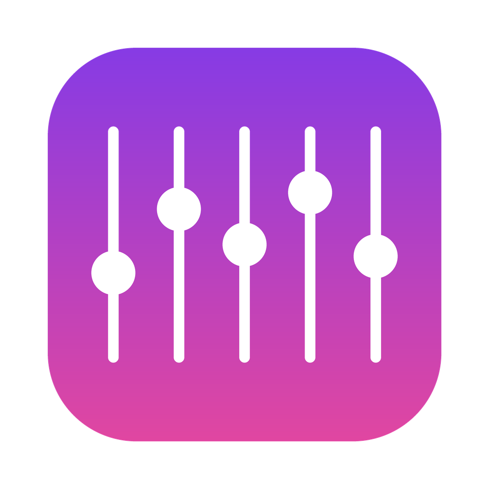

<p align="center">
  
</p>

<h1 align="center">EGPRO</h1>

<p align="center">Egalizator de sunet pentru Mac — pentru Spotify, Apple Music, YouTube și orice altă aplicație.</p>

---

## Ce face

- Stă **sus, lângă ceas**. Un click și ai egalizatorul.
- **10 benzi**: de la bas (32 Hz) până la înalte (16 kHz), fiecare între -12 și +12 dB.
- **Setări gata făcute**: Bas puternic, Bas extrem, Voce clară, Înalte, Petrecere, Rock, Pop, Căști, Noaptea.
- **Merge cu orice aplicație** care scoate sunet — nu trebuie conectat niciun cont.
- **Fără distorsiuni**: când ridici o bandă, volumul general scade automat puțin ca sunetul să nu se „spargă".
- **Fundal transparent** (sticlă mată), cu glisor ca să alegi cât de transparent.
- Când conectezi căștile sau schimbi boxele, EGPRO trece singur pe noua ieșire.
- Când îl oprești sau îl închizi, sunetul Mac-ului revine exact cum era.

## Instalare

1. Mergi la **[Releases](../../releases/latest)** și descarcă **EGPRO.dmg**.
2. Deschide-l și trage **EGPRO** în **Applications**.
3. Deschide EGPRO. Dacă Mac-ul îl blochează: **System Settings → Privacy & Security → „Open Anyway"**.
4. Când te întreabă de acces la sunet, apasă **Allow**.

**Necesită macOS 14.2 (Sonoma) sau mai nou.** Merge pe Mac-uri cu procesor Apple (M1–M4) și Intel.

## Cum funcționează (tehnic)

EGPRO folosește *Core Audio process taps* (macOS 14.2+): ia sunetul tuturor aplicațiilor, îl trece prin 10 filtre biquad (peaking EQ) și îl trimite la ieșirea curentă printr-un dispozitiv agregat privat.

- `Sources/EGAudio` — motorul audio (Objective-C / C)
- `Sources/EGPRO` — aplicația (SwiftUI, `MenuBarExtra`)
- `scripts/package.sh` — construiește `EGPRO.app` și `EGPRO.dmg`
- `.github/workflows/build.yml` — GitHub construiește automat aplicația la fiecare modificare

### Construire locală

```bash
./scripts/package.sh   # rezultatul: build/EGPRO.dmg
```

---

*English:* EGPRO is a free menu-bar equalizer for macOS 14.2+. It uses Core Audio process taps to apply a 10-band EQ to all system audio.
